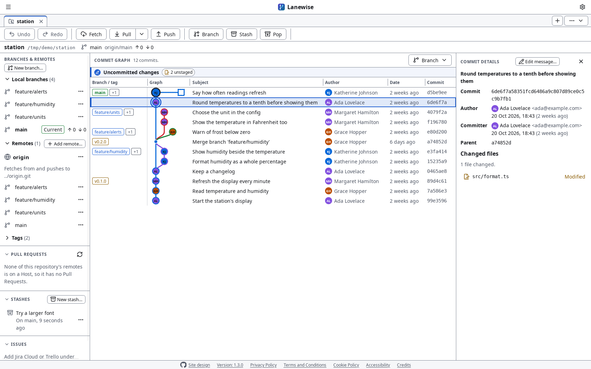
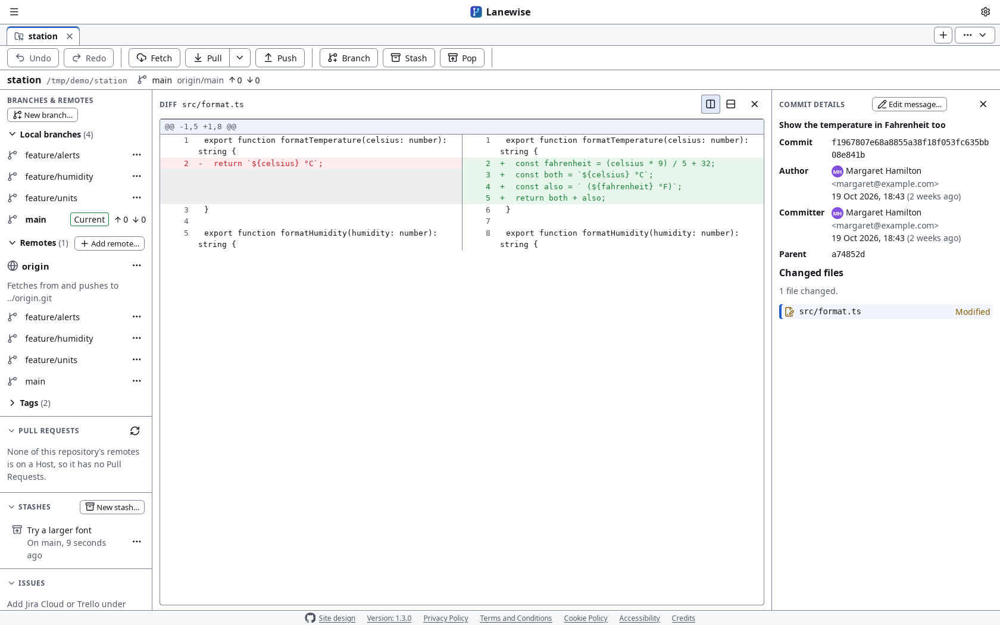
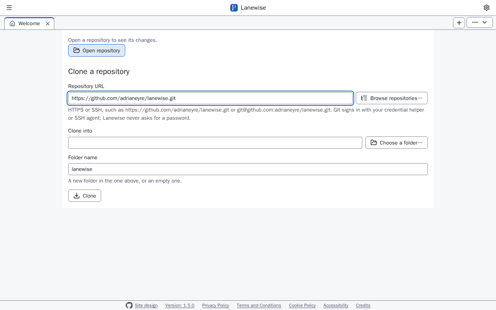

# First steps in Lanewise

[Back to the Setup guides](README.md) · [Back to the README](../../README.md)

Once Lanewise is installed and Git is set up, on [Windows](windows.md), [macOS](macos.md) or [Linux](linux.md), this is how to open your first repository and find your way round. Every picture here is a screenshot of Lanewise.

## 1. The Welcome screen

Lanewise opens on the Welcome screen when no repository is open. It has **Open repository**, the Clone form, and, once you've opened some, your Recent Repositories. The title bar's **Settings** button, the gear at the top right, opens Settings.

## 2. Open a repository on your computer

Choose **Open repository** and choose the repository's folder, or any folder inside it. It opens in a Tab of its own, with its Commit graph in the middle, its branches, remotes, tags, stashes and Pull Requests on the left, and the commit you choose on the right:

Choose a file in Commit details, or in the Working tree, to see its diff, split side by side:

## 3. Clone a repository

Paste its HTTPS or SSH URL into **Repository URL**, choose where in **Clone into**, and choose **Clone**. To sign in to GitHub, GitHub Enterprise Server, GitLab.com, Bitbucket or Azure DevOps and choose from your own repositories, choose **Browse repositories…**. Lanewise signs in through Git Credential Manager, which opens your browser to sign in.

Set a Base folder, such as `C:\projects` or `~/projects`, in Settings, and Open repository and Clone start there.

## 4. Turn on AI Suggestions, if you want them

AI is off until you turn it on, and Lanewise only ever calls a Model Provider with your own API key. Open **Settings**, and go to **AI**: choose your **Model Provider**, paste your API key, choose **Save**, and tick **Suggest Resolutions with AI**. Lanewise shows exactly what each Suggestion request sends, and to whom, before you agree. [Suggestions from your own Model Provider](../ai-suggestions.md) has every step, and where to make a key for each Model Provider.

## 5. Resolve a merge conflict

When a merge, rebase, cherry-pick or revert stops with conflicts, the repository's Tab shows the Conflicts page: the files still conflicted on the left, their Base, Ours and Theirs side by side, and the Resolution you build one Conflict Hunk at a time, with **Accept Ours**, **Accept Theirs** and **Accept both**. With AI on, **Suggest a resolution** in the AI Suggestion Widget asks for a Suggestion, which goes in only when you accept or edit it.

## Where next

- [Installing Lanewise](../installing.md#updates): how Lanewise updates itself.
- [The README](../../README.md#what-lanewise-does): everything Lanewise does.
- [Open an issue](https://github.com/adrianeyre/lanewise/issues/new/choose) to report a bug, ask for a feature or tell us about an accessibility barrier. Settings' **Copy diagnostics** fills the bug report's form in.
