# Setting up Lanewise on Linux

[Back to the Setup guides](README.md) · [Back to the README](../../README.md)

Lanewise ships for Windows and macOS. A Release has no Linux installer, but Lanewise is developed and tested on Linux, and you can build and run it there. This guide takes a Linux computer with nothing installed to Lanewise built from source, its checks passing, and in your applications menu. It's written for Ubuntu and Debian, with the commands for Fedora and Arch where they differ.

Each step has a picture. Those labelled **Recorded on Ubuntu 24.04** show the output these commands gave when every step of this guide was run, in order, on a fresh Ubuntu 24.04, with long output shortened. The rest are drawings of what you'll see.

Everything Lanewise needs is free.

## What you need

| | Where it comes from |
| --- | --- |
| A 64-bit Linux, x86_64 or aarch64, with a desktop | |
| [Git](https://git-scm.com/install/linux) 2.40 or later | Your package manager ([step 2](#2-install-git-and-the-system-packages)) |
| [Git Credential Manager](https://github.com/git-ecosystem/git-credential-manager), to sign in to Hosts | The `.deb` or tarball on [its Releases](https://github.com/git-ecosystem/git-credential-manager/releases/latest) ([step 4](#4-install-git-credential-manager)) |
| A Secret Service, such as GNOME Keyring or KWallet, to keep API keys and Git Credential Manager's credentials | Your package manager |
| [Tauri 2's system packages](https://v2.tauri.app/start/prerequisites/#linux): WebKitGTK 4.1, GTK 3, a C toolchain and others | Your package manager ([step 2](#2-install-git-and-the-system-packages)) |
| [nvm](https://github.com/nvm-sh/nvm), to install Node 26 (or [fnm](https://github.com/Schniz/fnm)) | The install script in [nvm's README](https://github.com/nvm-sh/nvm#installing-and-updating) |
| [corepack](https://github.com/nodejs/corepack), which provides [pnpm](https://pnpm.io) at the version in `packageManager` | `npm install -g corepack@latest` |
| [rustup](https://rustup.rs), for Rust stable with `clippy` and `rustfmt` | The install command on [rustup.rs](https://rustup.rs) |

Every command runs in a terminal: on Ubuntu, press Ctrl+Alt+T.

## 1. Check your distribution and processor

```bash
grep -E '^(PRETTY_NAME|VERSION_ID)=' /etc/os-release
uname -m
```

`x86_64` is a 64-bit Intel or AMD processor and `aarch64` is 64-bit Arm. Both build.

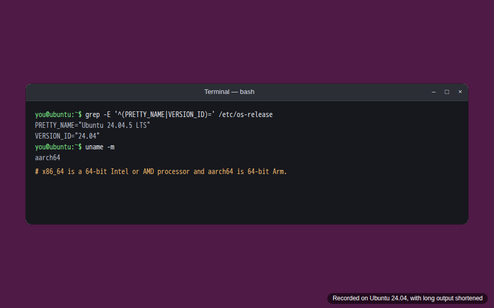

## 2. Install Git and the system packages

On Ubuntu or Debian, install Git, curl, a C toolchain, the packages Tauri 2 needs, and GNOME Keyring for the Secret Service:

```bash
sudo apt-get update
sudo apt-get install -y --no-install-recommends \
  git curl ca-certificates build-essential pkg-config libwebkit2gtk-4.1-dev libgtk-3-dev \
  librsvg2-dev libssl-dev libxdo-dev file gnome-keyring
pkg-config --modversion webkit2gtk-4.1   # prints WebKitGTK's version
git --version                            # git version 2.40.0 or later
```

On **Fedora**:

```bash
sudo dnf install git curl wget file webkit2gtk4.1-devel openssl-devel libxdo-devel librsvg2-devel gnome-keyring
sudo dnf group install c-development
```

On **Arch**:

```bash
sudo pacman -S --needed git curl wget file base-devel webkit2gtk-4.1 openssl xdotool librsvg gnome-keyring
```

Others are in [Tauri's list](https://v2.tauri.app/start/prerequisites/#linux). Only WebKitGTK 4.1 works with Tauri 2; 4.0 doesn't.

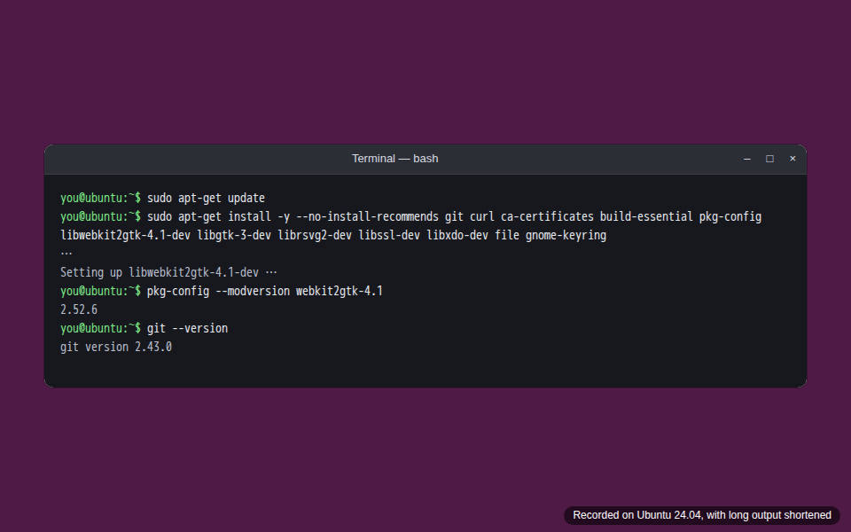

## 3. Get a newer Git, if yours is older than 2.40

Ubuntu 24.04's Git is 2.43, which is new enough. Ubuntu 22.04's is 2.34, which isn't. If `git --version` printed anything older than 2.40 on Ubuntu, add the Git team's [PPA](https://launchpad.net/~git-core/+archive/ubuntu/ppa) and install it again:

```bash
sudo add-apt-repository ppa:git-core/ppa
sudo apt-get update && sudo apt-get install -y git
git --version
```

On Debian, use its `backports` suite. Fedora and Arch have a new enough Git.

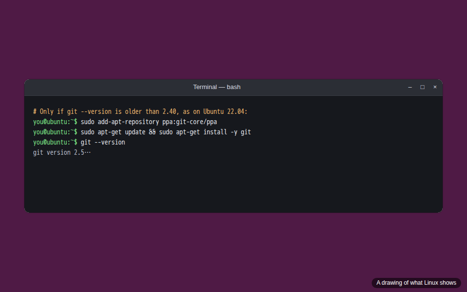

## 4. Install Git Credential Manager

Download the `.deb` for your processor from [Git Credential Manager's latest Release](https://github.com/git-ecosystem/git-credential-manager/releases/latest): `gcm-linux-x64-<version>.deb` for x86_64, `gcm-linux-arm64-<version>.deb` for aarch64. Install it, make it Git's credential helper, and have it keep credentials in the Secret Service:

```bash
curl -fsSLO https://github.com/git-ecosystem/git-credential-manager/releases/download/v3.0.2/gcm-linux-x64-3.0.2.deb
sudo dpkg -i gcm-linux-x64-3.0.2.deb
git-credential-manager configure
git config --global credential.credentialStore secretservice
git credential-manager --version
git config --get-all credential.helper   # one line ends git-credential-manager
```

On Fedora, Arch and others, use the `.tar.gz` and [its install instructions](https://github.com/git-ecosystem/git-credential-manager/blob/main/docs/install.md). Without Git Credential Manager, Lanewise still works with the repositories on your computer, SSH remotes and other credential helpers, but can't sign in to Hosts for you.


## 5. Install Node 26 with nvm

[nvm](https://github.com/nvm-sh/nvm), the Node Version Manager, installs Node versions and switches between them. Install it with the script from [its README](https://github.com/nvm-sh/nvm#installing-and-updating), open a new terminal, then install Node 26:

```bash
curl -fsSL -o- https://raw.githubusercontent.com/nvm-sh/nvm/v0.41.0/install.sh | bash
# Open a new terminal, then:
nvm install 26
nvm alias default 26
node --version
```

Prefer [fnm](https://github.com/Schniz/fnm)? `curl -fsSL https://fnm.vercel.app/install | bash`, open a new terminal, then `fnm install 26` and `fnm default 26`. Don't use your distribution's `nodejs` package: it's usually older than 26.

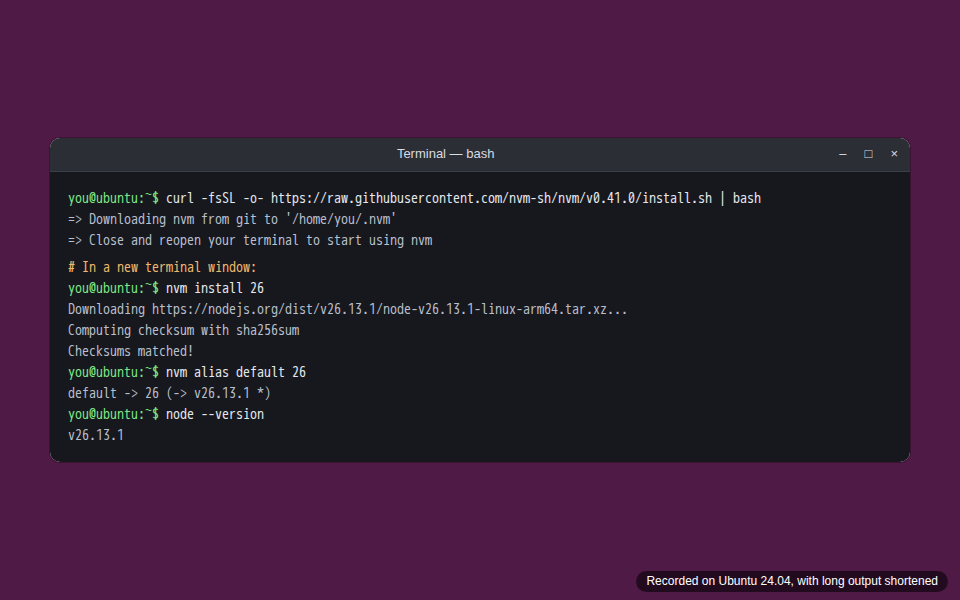

## 6. Turn on corepack, for pnpm

Lanewise uses [pnpm](https://pnpm.io) at the exact version in `package.json`'s `packageManager`. [corepack](https://github.com/nodejs/corepack) provides it. Node no longer comes with corepack, so install it with npm, which comes with Node:

```bash
npm install -g corepack@latest
corepack enable
corepack --version
```

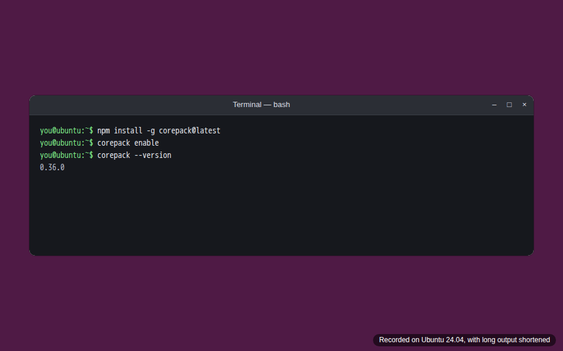

## 7. Install Rust

Install rustup, Rust's installer, with the command on [rustup.rs](https://rustup.rs), with clippy and rustfmt, and load it:

```bash
curl --proto '=https' --tlsv1.2 -sSf https://sh.rustup.rs | sh -s -- -y --component clippy,rustfmt
. "$HOME/.cargo/env"
rustc --version
cargo clippy --version
cargo fmt --version
```

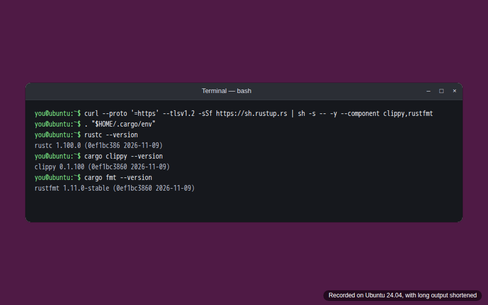

## 8. Clone Lanewise and install its packages

```bash
git clone https://github.com/adrianeyre/lanewise.git
cd lanewise
pnpm --version   # the version in packageManager; corepack downloads it the first time
pnpm install --frozen-lockfile
```

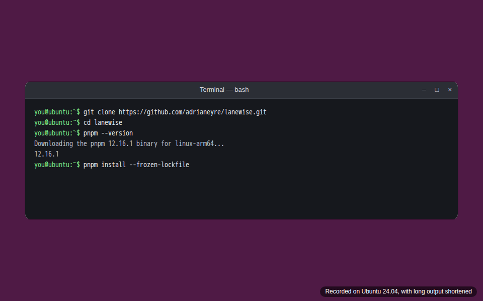

## 9. Run Lanewise from source

```bash
pnpm desktop:dev
```

The first build compiles every crate and takes several minutes. Then Lanewise's window opens. A change to the UI reloads at once, and a change to the Rust code rebuilds and restarts it. Press Ctrl+C in the terminal to stop it. If the window opens blank or white, your GPU driver can't draw WebKitGTK's accelerated compositing: run `WEBKIT_DISABLE_DMABUF_RENDERER=1 pnpm desktop:dev` instead.

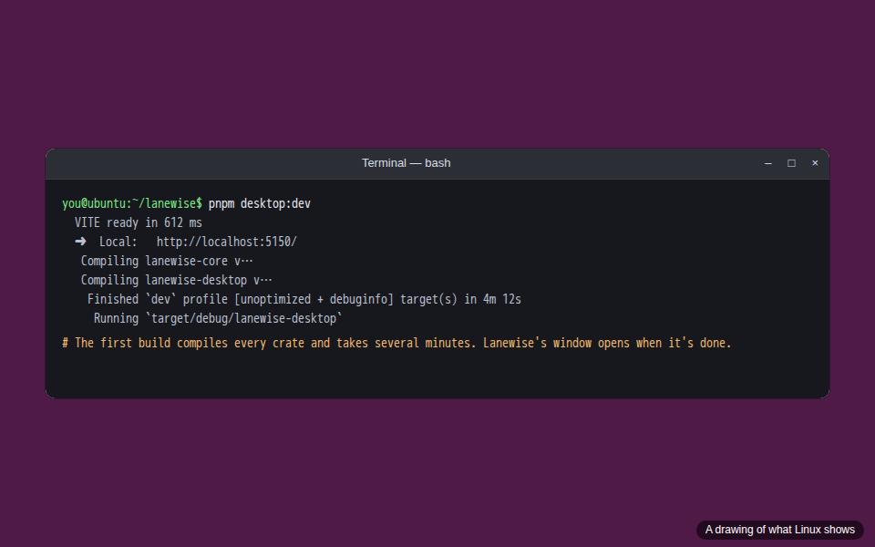

If anything Lanewise needs from Git is missing, it opens on **Set up Git for Lanewise**, which says what it found and what to install, with **Check again** to look again once you have. Here, it found Git but not Git Credential Manager:


Once Git is set up, it opens on the Welcome screen. Carry on with [First steps in Lanewise](first-steps.md).

## 10. Run the checks

These three must pass before a commit, as [CONTRIBUTING.md](../../CONTRIBUTING.md) says:

```bash
pnpm lint
pnpm typecheck
pnpm test
```

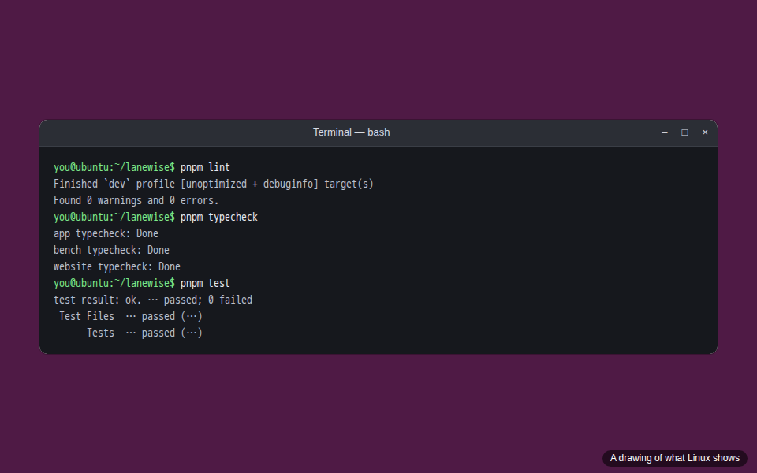

## 11. Build Lanewise for everyday use

`pnpm desktop:dev` is for working on Lanewise. For a copy to use every day, build the release binary:

```bash
pnpm exec tauri build --no-bundle
ls -lh target/release/lanewise-desktop
```

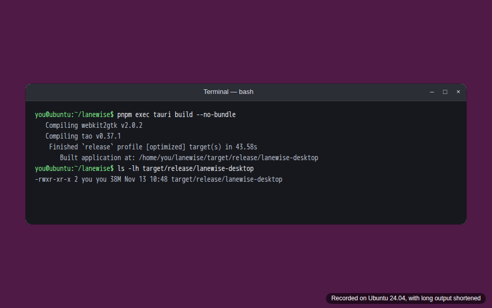

## 12. Add Lanewise to your applications

Copy the binary and its icon into your home folder, and write a desktop entry for it, so your desktop lists it:

```bash
install -Dm755 target/release/lanewise-desktop ~/.local/bin/lanewise
install -Dm644 desktop/icons/128x128.png ~/.local/share/icons/hicolor/128x128/apps/lanewise.png
printf '[Desktop Entry]\nType=Application\nName=Lanewise\nExec=%s\nIcon=lanewise\nCategories=Development;\n' "$HOME/.local/bin/lanewise" > ~/.local/share/applications/lanewise.desktop
update-desktop-database ~/.local/share/applications
```

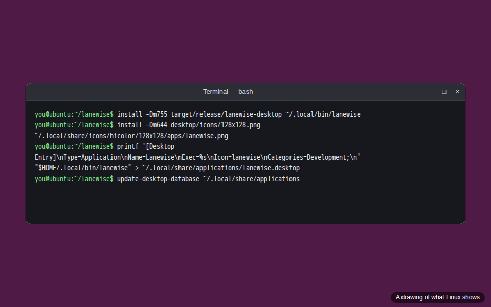

Then open your applications, search for `Lanewise` and choose it:

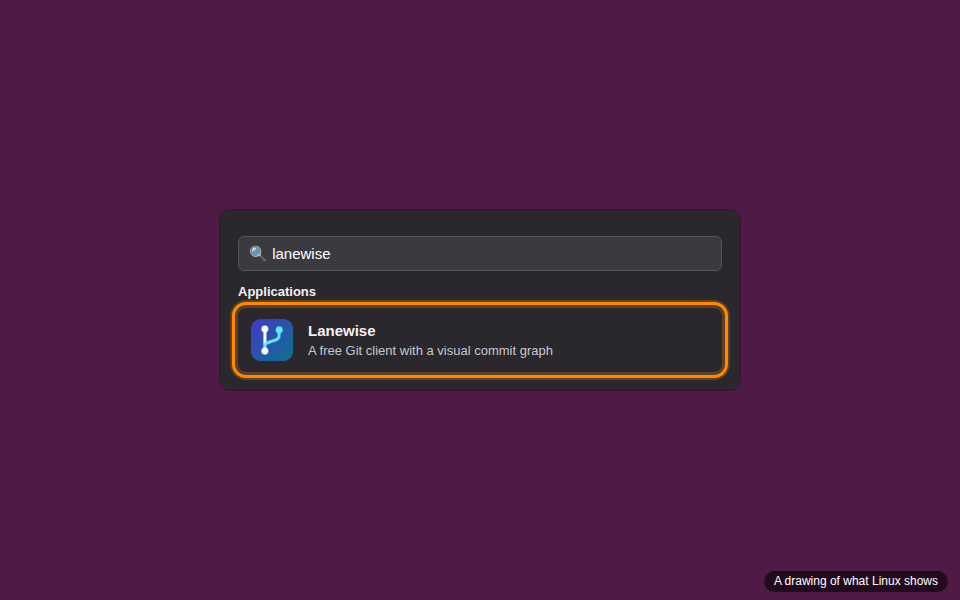

A copy you build yourself doesn't update itself. To update it, `git pull` in your clone, then do steps 8, 11 and 12 again. To remove it, delete `~/.local/bin/lanewise`, its icon and `~/.local/share/applications/lanewise.desktop`.

## If something goes wrong

- **`pkg-config` can't find `webkit2gtk-4.1`, `gtk+-3.0` or `openssl`.** Do [step 2](#2-install-git-and-the-system-packages).
- **The window opens blank or white.** `WEBKIT_DISABLE_DMABUF_RENDERER=1 pnpm desktop:dev`, or for the copy in step 12, `Exec=env WEBKIT_DISABLE_DMABUF_RENDERER=1 …` in its desktop entry.
- **Saving an API key says there's no credential store.** No Secret Service is running. Start GNOME Keyring or KWallet, and unlock it.
- **Git Credential Manager says no credential store has been selected.** `git config --global credential.credentialStore secretservice`.
- **Rust tests say they need Git 2.40 or later.** Do [step 3](#3-get-a-newer-git-if-yours-is-older-than-240).
- **Anything else.** [Common setup problems](../development.md#common-setup-problems), or [open an issue](https://github.com/adrianeyre/lanewise/issues/new/choose); Settings' **Copy diagnostics** fills its form in.
