# Setting up Lanewise on macOS

[Back to the Setup guides](README.md) · [Back to the README](../../README.md)

This guide takes a Mac with nothing installed to Lanewise running. [Part 1](#part-1-install-lanewise-from-a-release) installs the Desktop App from a Release and gets it past Gatekeeper, which is all most people need. [Part 2](#part-2-build-lanewise-from-source) builds it from source, to work on Lanewise itself. Each step has a picture. The pictures of Lanewise are screenshots of the app. The pictures of macOS are drawings of what it shows, labelled as drawings, so yours may look a little different with your version of macOS and its appearance.

Everything Lanewise needs is free. Lanewise has no Apple Developer account, so its Mac app is signed ad hoc and never notarized by Apple (ADR 0029). That's why macOS warns about it the first time, and why [step 7](#7-open-lanewise-the-first-time-past-gatekeeper) and [step 8](#8-or-allow-lanewise-from-terminal) exist.

## What you need

| | Where it comes from | Needed for |
| --- | --- | --- |
| macOS 14 or later, on Apple Silicon or Intel | | Both parts |
| [Homebrew](https://brew.sh), the package manager for macOS | The install command on [brew.sh](https://brew.sh) ([step 2](#2-install-homebrew)) | Both parts |
| [Git](https://git-scm.com/install/mac) 2.40 or later. The Git in Apple's Command Line Tools can be older | `brew install git` | Both parts |
| [Git Credential Manager](https://github.com/git-ecosystem/git-credential-manager), to sign in to Hosts | `brew install --cask git-credential-manager` | Both parts |
| The Xcode Command Line Tools | `xcode-select --install` | Part 2 |
| [nvm](https://github.com/nvm-sh/nvm), to install Node 26 (or [fnm](https://github.com/Schniz/fnm), `brew install fnm`, or the installer from [nodejs.org](https://nodejs.org/en/download)) | The install script in [nvm's README](https://github.com/nvm-sh/nvm#installing-and-updating) | Part 2 |
| [corepack](https://github.com/nodejs/corepack), which provides [pnpm](https://pnpm.io) at the version in `packageManager` | `npm install -g corepack@latest` | Part 2 |
| [rustup](https://rustup.rs), for Rust stable with `clippy` and `rustfmt` | The install command on [rustup.rs](https://rustup.rs) | Part 2 |

Every command runs in **Terminal**: open **Spotlight** with ⌘ Space, type `Terminal` and press Return.

## Part 1: install Lanewise from a Release

### 1. Check your version of macOS and your chip

Choose ** → About This Mac**, or run:

```bash
sw_vers
uname -m
```

`ProductVersion` must be 14 or later. `arm64` is Apple Silicon and `x86_64` is Intel; Lanewise's disk image runs on both.

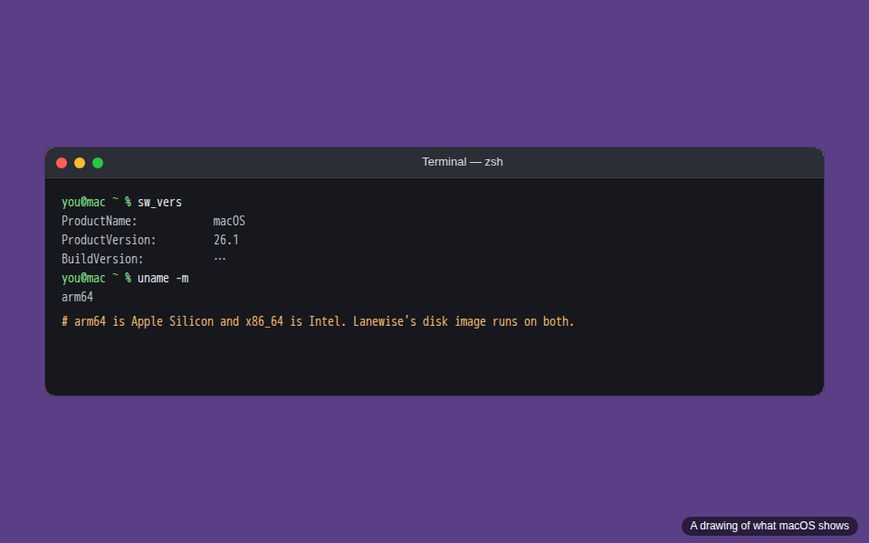

### 2. Install Homebrew

[Homebrew](https://brew.sh) installs Git and Git Credential Manager. Skip this step if `brew --version` already prints a version. Otherwise, paste the command from [brew.sh](https://brew.sh) into Terminal, press Return and give your password when it asks:

```bash
/bin/bash -c "$(curl -fsSL https://raw.githubusercontent.com/Homebrew/install/HEAD/install.sh)"
```

On Apple Silicon, it ends with **Next steps** that put `brew` on your `PATH`. Run them:

```bash
echo 'eval "$(/opt/homebrew/bin/brew shellenv)"' >> ~/.zprofile
eval "$(/opt/homebrew/bin/brew shellenv)"
brew --version
```

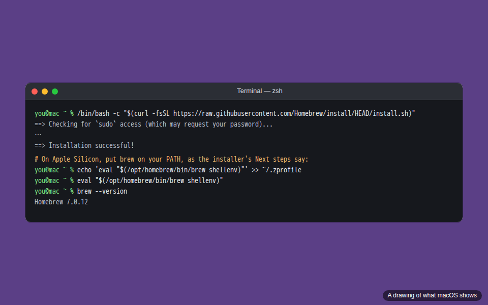

### 3. Install Git and Git Credential Manager

```bash
brew install git
brew install --cask git-credential-manager
```

If Lanewise doesn't find Git Credential Manager later, run `git-credential-manager configure`.

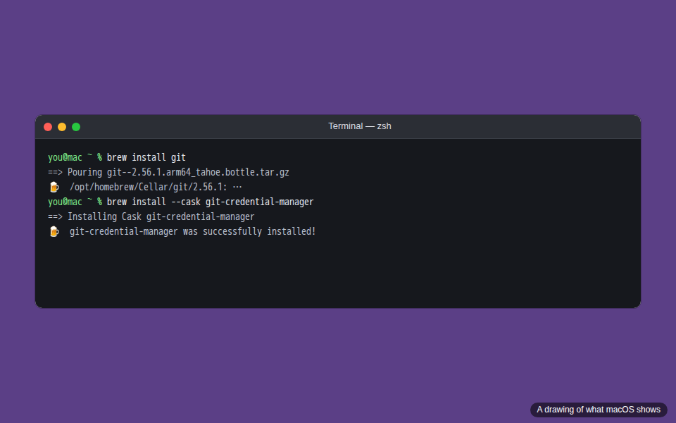

### 4. Check Git and Git Credential Manager

Open a new Terminal window, then:

```bash
which git                                # /opt/homebrew/bin/git on Apple Silicon, /usr/local/bin/git on Intel
git --version                            # git version 2.40.0 or later
git credential-manager --version         # any version
git config --get-all credential.helper   # one line ends git-credential-manager
```

If `which git` prints `/usr/bin/git`, that's Apple's Git, which can be older than 2.40: check that `/opt/homebrew/bin` comes before `/usr/bin` in `echo $PATH`, as step 2 set it up.


### 5. Download the disk image

On [the project website](https://lanewise.adrianeyre.co.uk/#download), choose **Download for macOS**, or download `Lanewise_<version>_universal.dmg` from the [latest Release](https://github.com/adrianeyre/lanewise/releases/latest). It's saved to your Downloads folder.

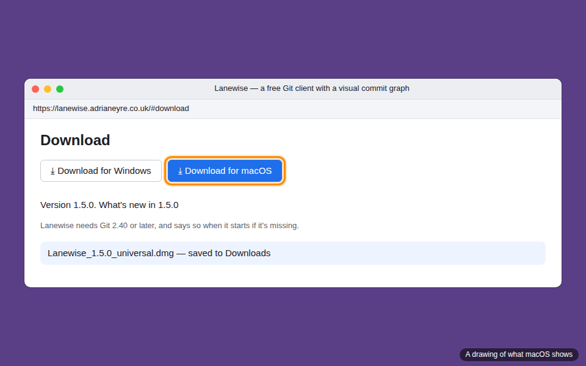

Or download it from Terminal, which asks GitHub for the latest Release's disk image. macOS doesn't put its quarantine mark on a file `curl` downloads, so a copy downloaded this way opens without Gatekeeper's warning, and you can skip steps 7 and 8:

```bash
cd ~/Downloads
curl -fsSL https://api.github.com/repos/adrianeyre/lanewise/releases/latest | grep -o 'https://[^"]*_universal\.dmg' | head -n 1 | xargs curl -fLO
ls Lanewise_*_universal.dmg
```

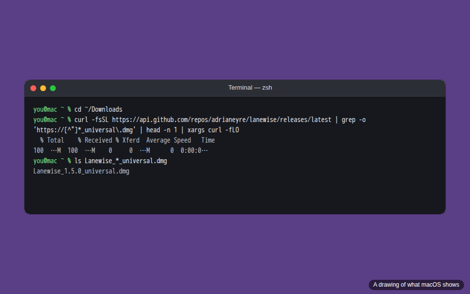

### 6. Copy Lanewise to Applications

Double-click the disk image to open it, drag **Lanewise** onto **Applications**, then eject the disk image: choose ⏏ beside **Lanewise** in Finder's sidebar.

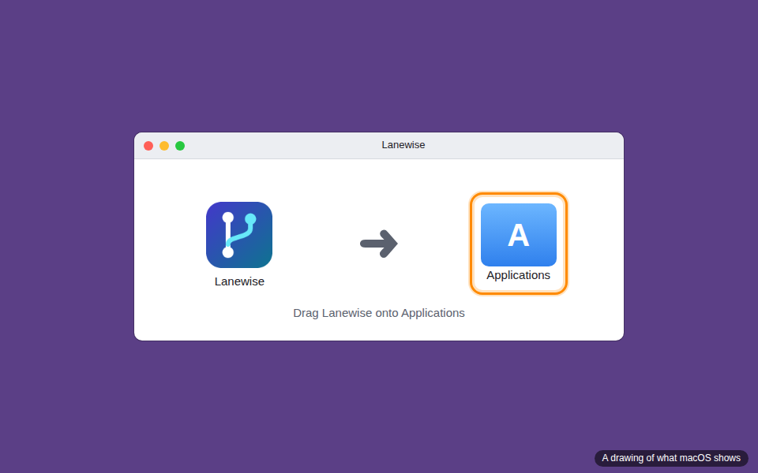

Or do it from Terminal:

```bash
hdiutil attach -nobrowse -mountpoint /tmp/lanewise-dmg ~/Downloads/Lanewise_*_universal.dmg
ditto /tmp/lanewise-dmg/Lanewise.app /Applications/Lanewise.app
hdiutil detach /tmp/lanewise-dmg
```

Mounting it at a folder of its own, rather than under `/Volumes`, means the commands work even when another Lanewise disk image is already open.

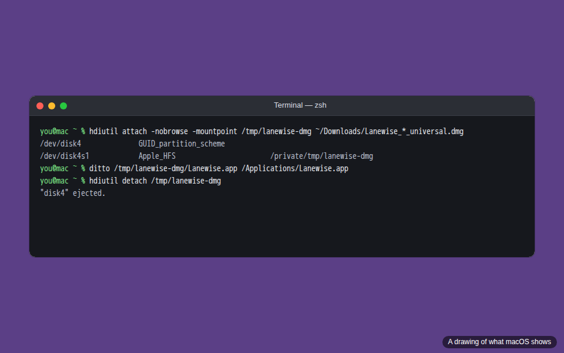

Open Lanewise from Applications, not from the disk image or Downloads. macOS runs a quarantined app from somewhere else on disk when it hasn't been moved, and it can't update itself there.

### 7. Open Lanewise the first time, past Gatekeeper

Double-click **Lanewise** in Applications. Because it isn't notarized, macOS won't open a downloaded copy the first time. On macOS 15 or later it says **“Lanewise” Not Opened**. Choose **Done**, not **Move to Bin**:

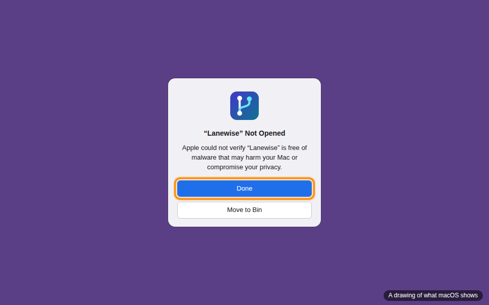

Then open **System Settings → Privacy & Security**, scroll to **Security**, and choose **Open Anyway** beside “Lanewise” was blocked to protect your Mac:

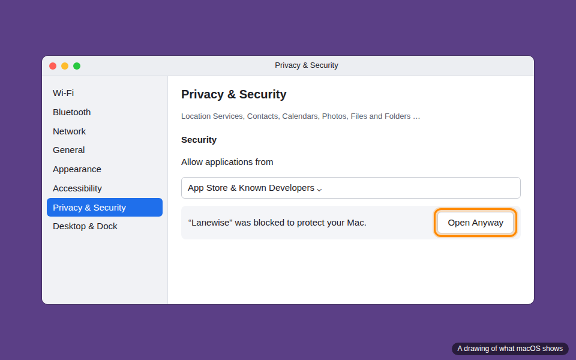

macOS asks for your password or Touch ID. Give it and choose **Modify Settings**:

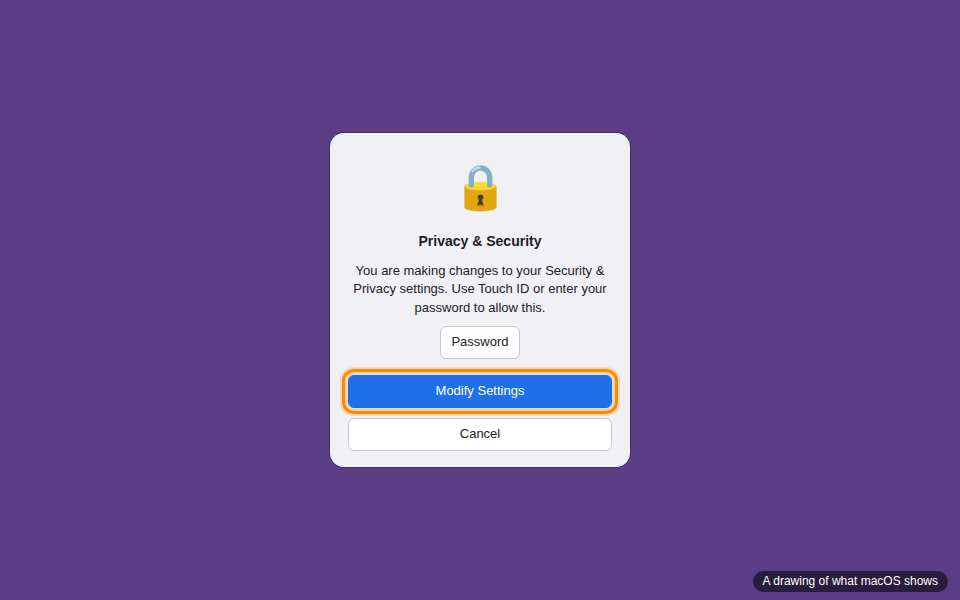

Open Lanewise again. macOS asks once more; choose **Open Anyway**:

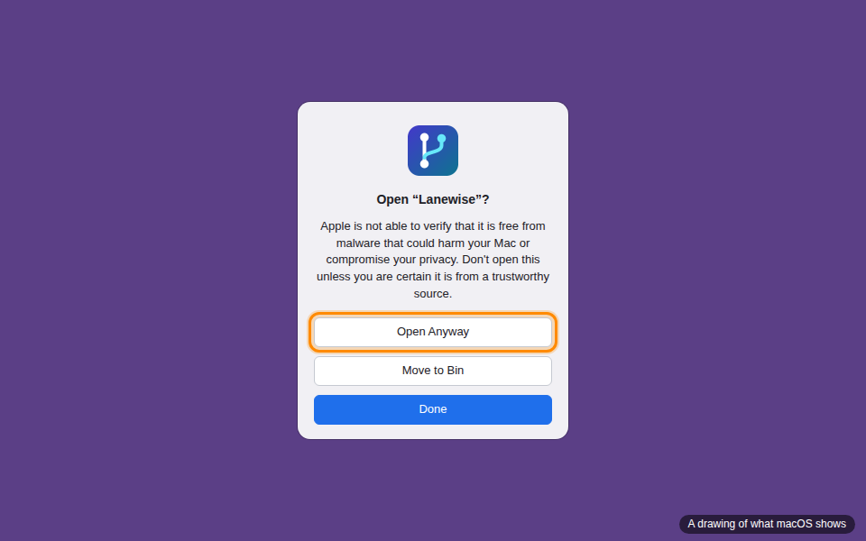

From then on Lanewise opens as any other app does. On macOS 14, the first message says Apple **cannot check it for malicious software**, and Control-click → **Open** also works. On macOS 15 and later it doesn't, so use **Open Anyway** or [step 8](#8-or-allow-lanewise-from-terminal).

### 8. Or allow Lanewise from Terminal

Instead of step 7, remove the quarantine mark macOS put on the app when it was downloaded. Look at it first, remove it, check it has gone and open Lanewise:

```bash
xattr -l /Applications/Lanewise.app                        # lists com.apple.quarantine
xattr -d com.apple.quarantine /Applications/Lanewise.app   # removes it
xattr -l /Applications/Lanewise.app                        # prints nothing now
open /Applications/Lanewise.app
```

If `xattr -d` says `No such xattr: com.apple.quarantine`, the app has no quarantine mark, as when `curl` downloaded it, and there's nothing to remove.

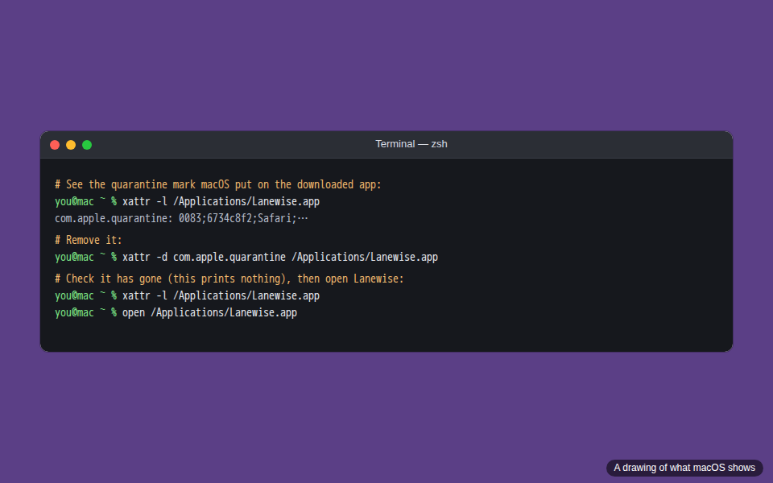

If macOS still stops it, remove the mark from every file inside the app, with `-r`. If Lanewise is in an Applications folder you can't write to without an administrator's password, put `sudo` before it. You can also check the app is the one the Release built, signed ad hoc and for both chips:

```bash
xattr -dr com.apple.quarantine /Applications/Lanewise.app
codesign -dv /Applications/Lanewise.app 2>&1 | grep -E 'Identifier|Signature'   # Identifier=com.adrianeyre.lanewise, Signature=adhoc
codesign --verify --deep --strict --verbose=2 /Applications/Lanewise.app        # valid on disk
lipo -archs /Applications/Lanewise.app/Contents/MacOS/lanewise-desktop          # x86_64 arm64
```


`spctl --assess --verbose /Applications/Lanewise.app` says `rejected` even then: that's Gatekeeper's verdict on an app that isn't notarized, and doesn't stop Lanewise opening once the quarantine mark has gone. Never turn Gatekeeper off for the whole Mac (`spctl --master-disable`) to open Lanewise; only Lanewise needs allowing.

### If macOS says Lanewise is damaged

If macOS says **“Lanewise” is damaged and can’t be opened**, choose **Cancel**, not **Move to Bin**. It means the app's signature didn't check out on this Mac, usually because the download was changed on its way, or a tool added attributes to it:

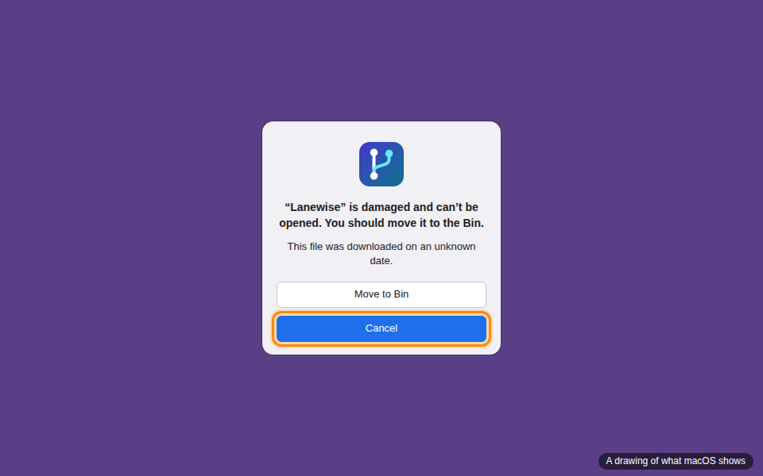

Clear every extended attribute from the app and open it. If it's still damaged, sign it ad hoc again on this Mac, as the Release did, and open it. If it's damaged even then, download the disk image again:

```bash
xattr -cr /Applications/Lanewise.app
open /Applications/Lanewise.app
codesign --force --deep --sign - /Applications/Lanewise.app
open /Applications/Lanewise.app
```

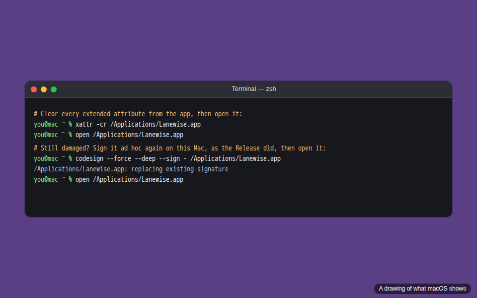

### 9. Set up Git, if Lanewise asks

If anything Lanewise needs from Git is missing, it opens on **Set up Git for Lanewise**, which says what it found and what to install, with **Check again** to look again once you have. Here, it found Apple's Git, which is too old, and no Git Credential Manager:


Once Git is set up, it opens on the Welcome screen. Carry on with [First steps in Lanewise](first-steps.md). Lanewise updates itself from then on: **Settings → Updates** says which version is running ([Updates](../installing.md#updates)). If macOS stops an updated Lanewise again, do step 7 or step 8 again.

### Uninstalling

Quit Lanewise, then drag it from Applications to the Bin, or, in Terminal, remove the app, and its Settings, Logs and caches as well if you want:

```bash
rm -rf /Applications/Lanewise.app
rm -rf ~/Library/Application\ Support/com.adrianeyre.lanewise ~/Library/Caches/com.adrianeyre.lanewise ~/Library/Logs/com.adrianeyre.lanewise ~/Library/WebKit/com.adrianeyre.lanewise
```

Your API keys stay in your Keychain until you choose **Forget the API key** in Lanewise's Settings first.

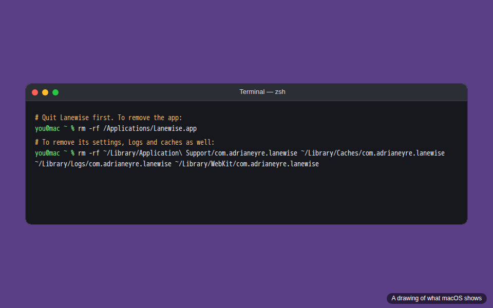

## Part 2: build Lanewise from source

Part 2 needs Homebrew and Git from steps 2 to 4. It ends with Lanewise running from your clone, its checks passing and its disk image built. [Setting Lanewise up locally](../development.md) says more about each command. A copy you build on your own Mac opens without Gatekeeper's warning.

### 10. Install the Xcode Command Line Tools

```bash
xcode-select --install
```

macOS asks whether to install them. Choose **Install**, and agree to the licence:

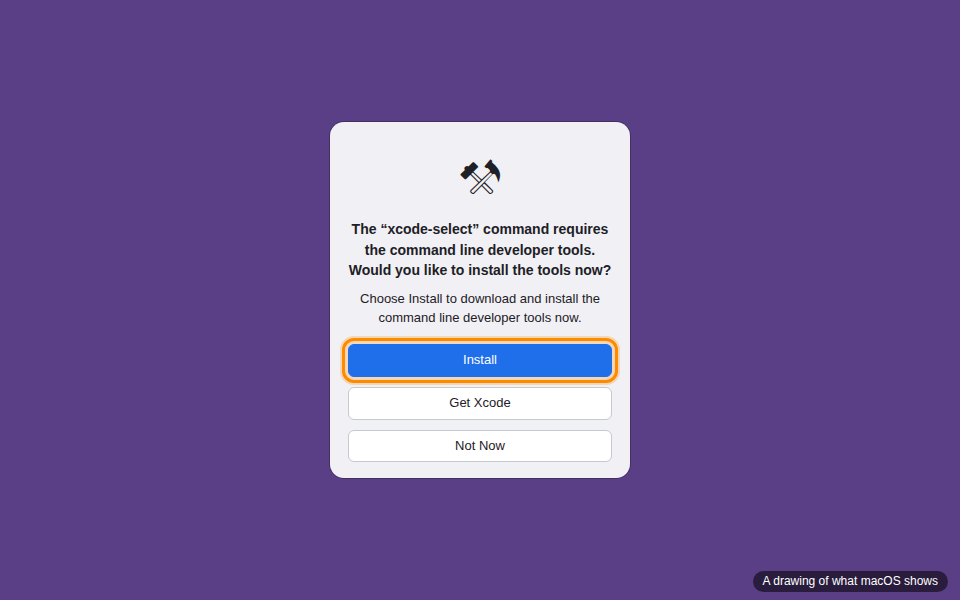

Once the installer has finished, check where they are:

```bash
xcode-select -p   # /Library/Developer/CommandLineTools, or Xcode's folder if you have Xcode
```

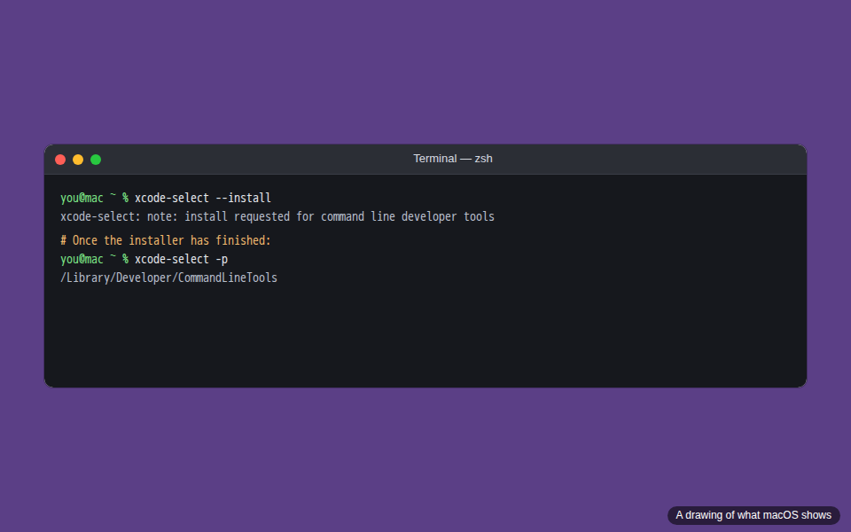

### 11. Install Node 26 with nvm

[nvm](https://github.com/nvm-sh/nvm), the Node Version Manager, installs Node versions and switches between them. Install it with the script from [its README](https://github.com/nvm-sh/nvm#installing-and-updating), open a new Terminal window, then install Node 26:

```bash
curl -fsSL -o- https://raw.githubusercontent.com/nvm-sh/nvm/v0.41.0/install.sh | bash
# Open a new Terminal window, then:
nvm install 26
nvm alias default 26
node --version
```

Prefer another way? [fnm](https://github.com/Schniz/fnm): `brew install fnm`, add `eval "$(fnm env --use-on-cd --shell zsh)"` to `~/.zshrc`, open a new window, then `fnm install 26` and `fnm default 26`. Or the **macOS Installer (.pkg)** for Node 26 from [nodejs.org](https://nodejs.org/en/download).

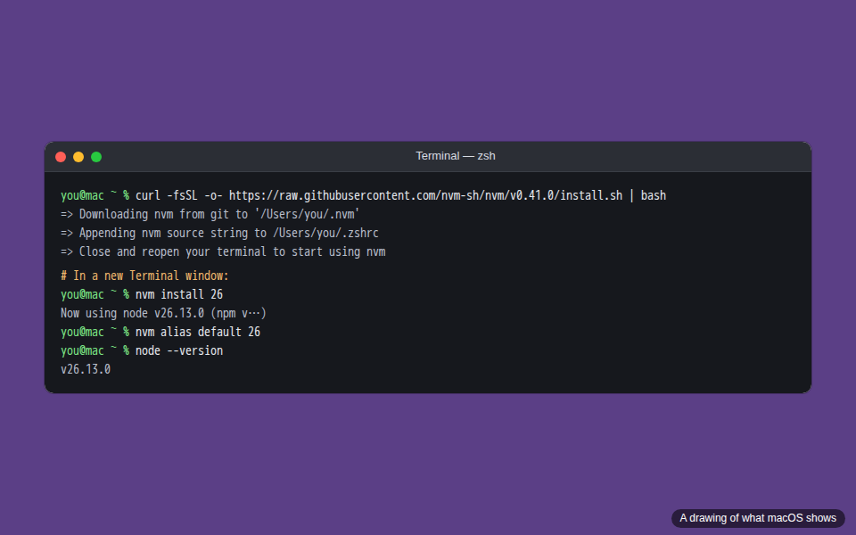

### 12. Turn on corepack, for pnpm

Lanewise uses [pnpm](https://pnpm.io) at the exact version in `package.json`'s `packageManager`. [corepack](https://github.com/nodejs/corepack) provides it. Node no longer comes with corepack, so install it with npm, which comes with Node:

```bash
npm install -g corepack@latest
corepack enable
corepack --version
```

Don't install pnpm with Homebrew or npm as well; if you have, `brew uninstall pnpm` or `npm uninstall -g pnpm`. Once you've cloned Lanewise, `pnpm --version` inside the clone prints the version in `packageManager`.

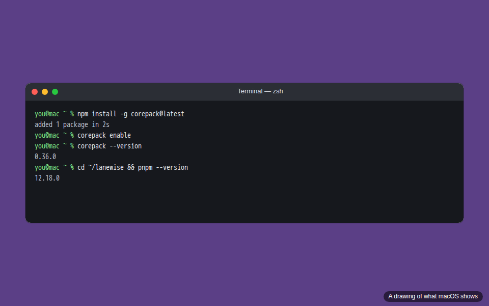

### 13. Install Rust

Install rustup, Rust's installer, with the command on [rustup.rs](https://rustup.rs), and press Return for the standard installation. Then load it, and add clippy, rustfmt and both Mac targets, for the universal app:

```bash
curl --proto '=https' --tlsv1.2 -sSf https://sh.rustup.rs | sh
. "$HOME/.cargo/env"
rustup component add clippy rustfmt
rustup target add aarch64-apple-darwin x86_64-apple-darwin
rustc --version
```

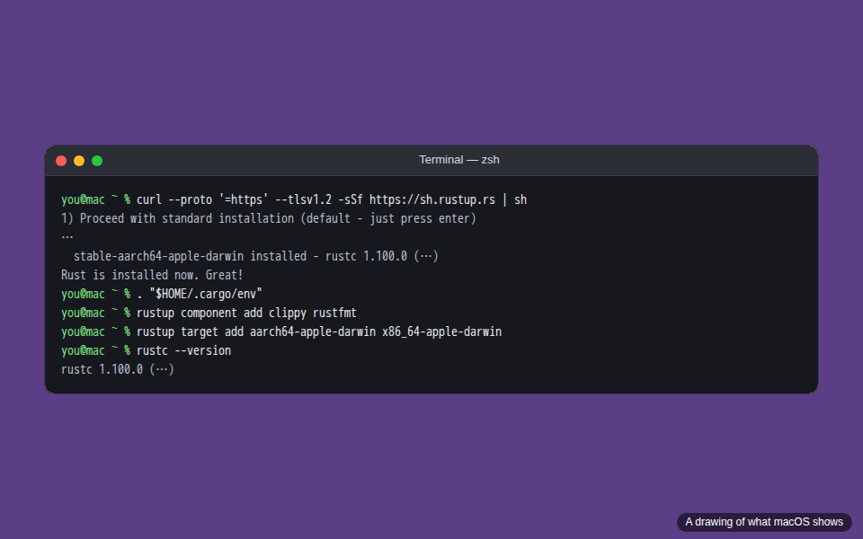

### 14. Clone Lanewise and install its packages

```bash
cd ~
git clone https://github.com/adrianeyre/lanewise.git
cd lanewise
pnpm install --frozen-lockfile
```

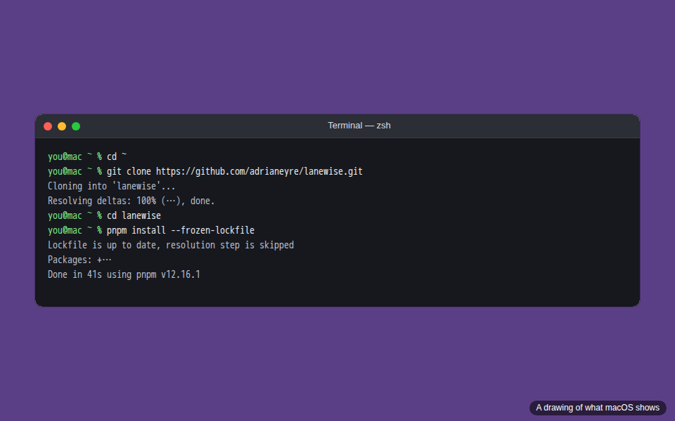

### 15. Run Lanewise from source

```bash
pnpm desktop:dev
```

The first build compiles every crate and takes several minutes. Then Lanewise's window opens, without a Gatekeeper warning. A change to the UI reloads at once, and a change to the Rust code rebuilds and restarts it. Press Control-C in Terminal to stop it.

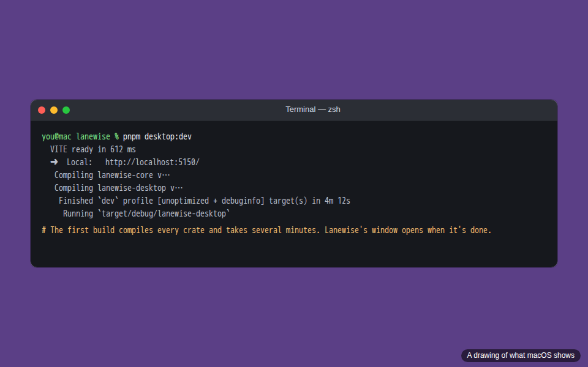

### 16. Run the checks

These three must pass before a commit, as [CONTRIBUTING.md](../../CONTRIBUTING.md) says:

```bash
pnpm lint
pnpm typecheck
pnpm test
```

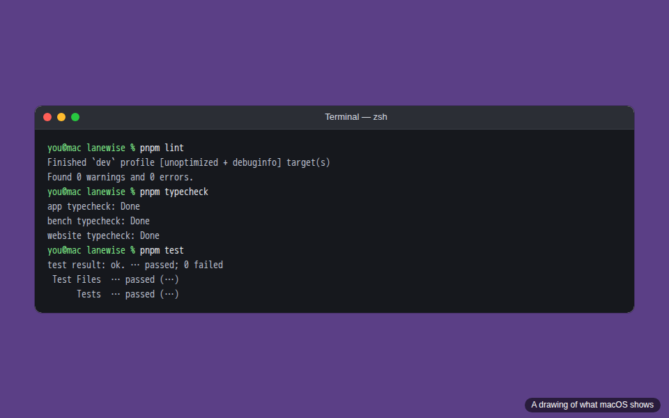

### 17. Build the app and its disk image

To build the universal app, signed ad hoc as a Release is:

```bash
node app/scripts/release/signMacos.ts -- pnpm desktop:build --target universal-apple-darwin
```

It writes `target/universal-apple-darwin/release/bundle/dmg/Lanewise_<version>_universal.dmg`. `pnpm desktop:build` alone builds for your Mac's chip only, under `target/release/bundle/`. Install either as in [step 6](#6-copy-lanewise-to-applications); built on your Mac, it has no quarantine mark. A copy you build yourself doesn't update itself.

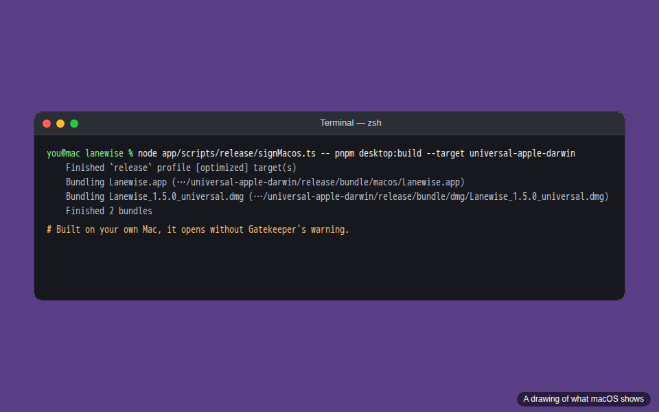

## If something goes wrong

- **`zsh: command not found: brew`.** On Apple Silicon, do step 2's **Next steps**, then open a new Terminal window.
- **`xcrun: error: invalid active developer path`.** Run `xcode-select --install`.
- **`nvm: command not found`.** Open a new Terminal window. If it's still not found, nvm's script couldn't find a profile: run `touch ~/.zshrc` and its install command again.
- **Rust tests say they need Git 2.40 or later.** `which git` names Apple's: see [step 4](#4-check-git-and-git-credential-manager).
- **`can't find crate for std` building the universal app.** `rustup target add aarch64-apple-darwin x86_64-apple-darwin`.
- **Anything else.** [Common setup problems](../development.md#common-setup-problems), or [open an issue](https://github.com/adrianeyre/lanewise/issues/new/choose); Settings' **Copy diagnostics** fills its form in.
