# Setting up Lanewise on Windows

[Back to the Setup guides](README.md) · [Back to the README](../../README.md)

This guide takes a Windows computer with nothing installed to Lanewise running. [Part 1](#part-1-install-lanewise-from-a-release) installs the Desktop App from a Release, which is all most people need. [Part 2](#part-2-build-lanewise-from-source) builds it from source, to work on Lanewise itself. Each step has a picture. The pictures of Lanewise are screenshots of the app. The pictures of Windows are drawings of what it shows, labelled as drawings, so yours may look a little different with your version of Windows and its theme.

Everything Lanewise needs is free.

## What you need

| | Where it comes from | Needed for |
| --- | --- | --- |
| Windows 10 22H2 or later, or Windows 11, on x64 | | Both parts |
| [Git for Windows](https://git-scm.com/install/windows) 2.40 or later, with Git Credential Manager | `winget install --id Git.Git -e --source winget` | Both parts |
| [Microsoft C++ Build Tools](https://visualstudio.microsoft.com/visual-cpp-build-tools/), with **Desktop development with C++** | `winget install --id Microsoft.VisualStudio.2022.BuildTools` ([step 9](#9-install-the-microsoft-c-build-tools)) | Part 2 |
| [WebView2](https://developer.microsoft.com/microsoft-edge/webview2/) | Already in Windows 10 (1803 and later) and Windows 11 | Both parts |
| [rustup](https://rustup.rs), for Rust stable with `clippy` and `rustfmt` | `winget install --id Rustlang.Rustup -e --source winget` | Part 2 |
| [fnm](https://github.com/Schniz/fnm), to install Node 26 (or [nvm-windows](https://github.com/coreybutler/nvm-windows), or the installer from [nodejs.org](https://nodejs.org/en/download)) | `winget install --id Schniz.fnm -e --source winget` | Part 2 |
| [corepack](https://github.com/nodejs/corepack), which provides [pnpm](https://pnpm.io) at the version in `packageManager` | `npm install -g corepack@latest` | Part 2 |

[winget](https://learn.microsoft.com/windows/package-manager/winget/), the Windows Package Manager, comes with Windows 11 and recent Windows 10 as **App Installer**. If `winget` isn't found, install **App Installer** from the Microsoft Store, or download each tool from the link in the first column instead.

## Part 1: install Lanewise from a Release

### 1. Check your version of Windows

Open **Start**, type `winver` and press Enter, or run this in PowerShell. Lanewise needs version 22H2 or later on Windows 10, any Windows 11, and a 64-bit Windows.

```powershell
Get-ComputerInfo -Property OsName, OSDisplayVersion, OsArchitecture
```

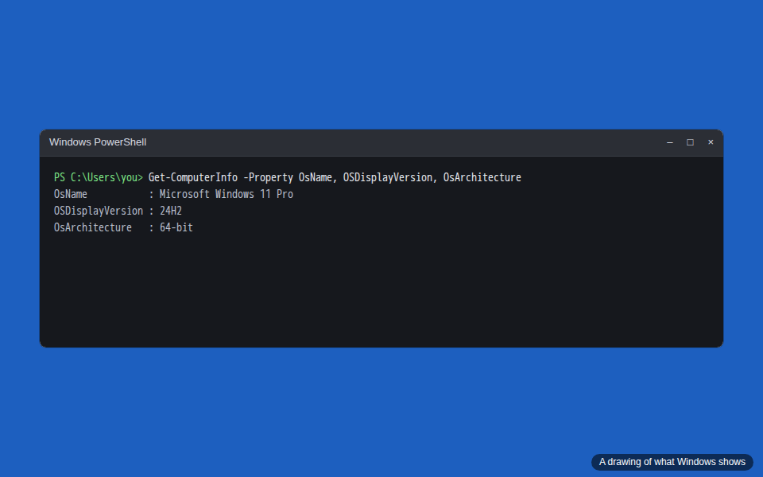

### 2. Open a terminal

Open **Start**, type `Terminal`, and choose **Terminal**. On Windows 10 without Terminal, choose **Windows PowerShell**. Every command in this guide runs there. You don't need to run it as administrator.

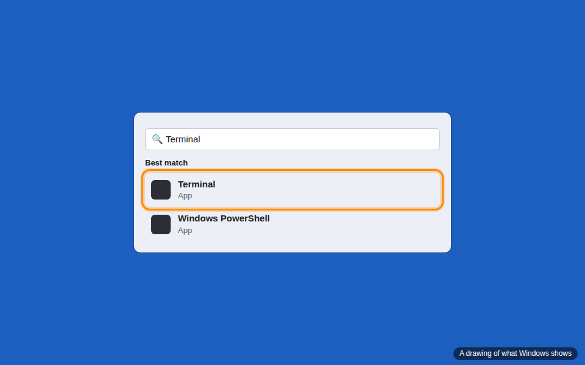

### 3. Install Git and Git Credential Manager

Lanewise runs the Git installed on your computer, which must be 2.40 or later, and signs in to Hosts through Git Credential Manager. Git for Windows includes both, and sets Git Credential Manager up as Git's credential helper. Install it with winget, or download it from [git-scm.com/install/windows](https://git-scm.com/install/windows) and keep the installer's defaults:

```powershell
winget install --id Git.Git -e --source winget
```

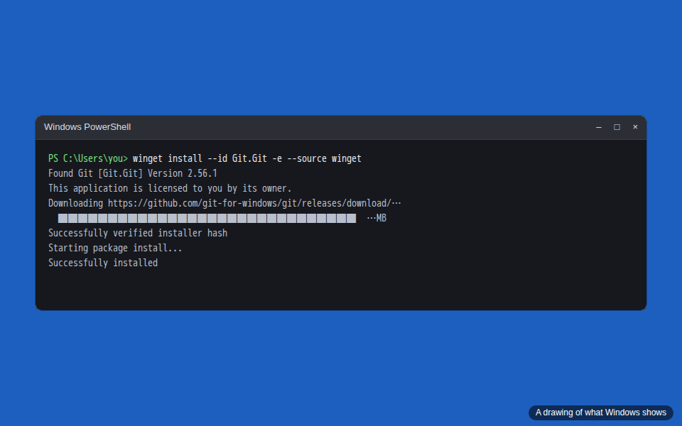

### 4. Check Git and Git Credential Manager

Close the terminal and open a new one, so it finds the Git you just installed, then:

```powershell
git --version                            # git version 2.40.0 or later
git credential-manager --version         # any version
git config --get-all credential.helper   # manager
```

If the last command doesn't print `manager`, run `git config --global credential.helper manager`.

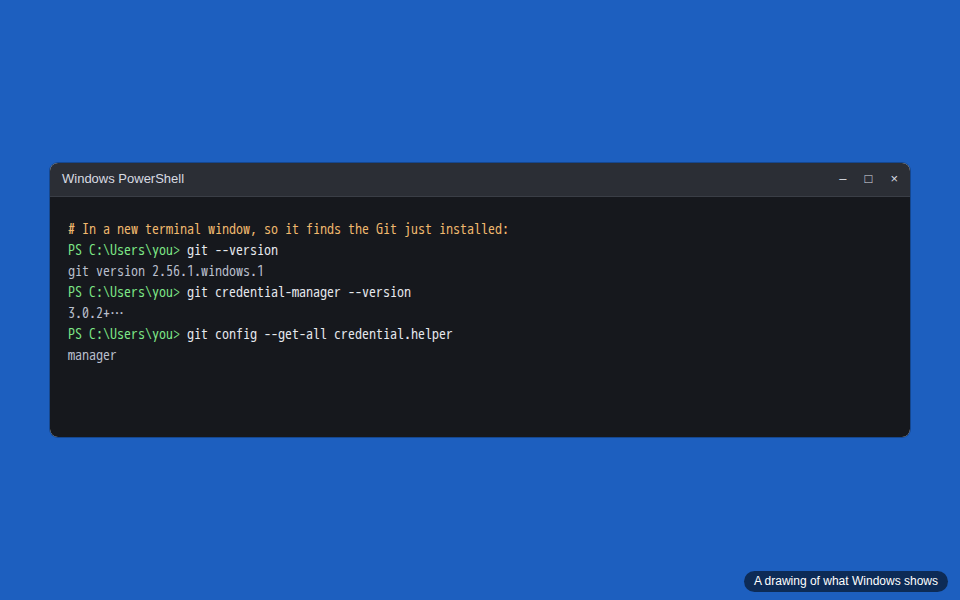

### 5. Download the installer

On [the project website](https://lanewise.adrianeyre.co.uk/#download), choose **Download for Windows**, or download `Lanewise_<version>_x64-setup.exe` from the [latest Release](https://github.com/adrianeyre/lanewise/releases/latest). It's saved to your Downloads folder.

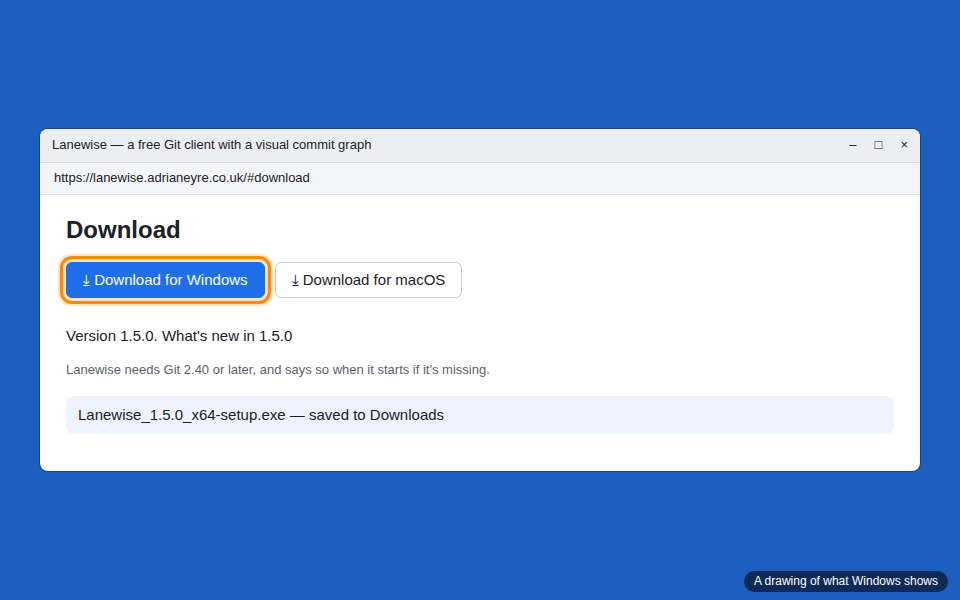

Or download it from PowerShell, which asks GitHub for the latest Release's installer:

```powershell
$release = Invoke-RestMethod https://api.github.com/repos/adrianeyre/lanewise/releases/latest
$installer = $release.assets | Where-Object name -like '*_x64-setup.exe'
Invoke-WebRequest $installer.browser_download_url -OutFile "$HOME\Downloads\$($installer.name)"
```

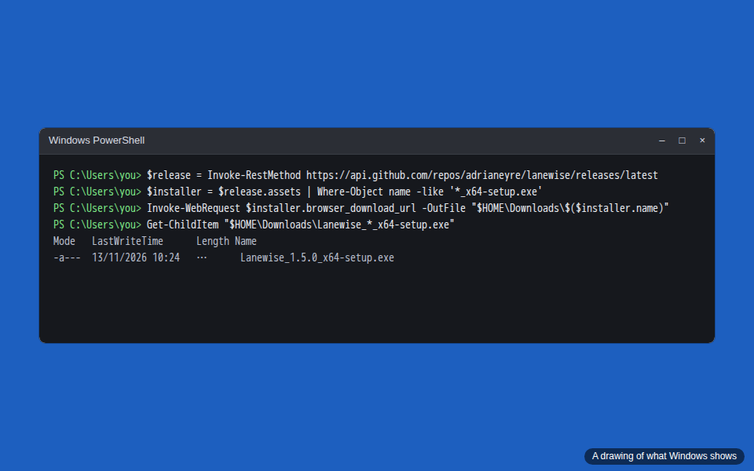

### 6. Run the installer, past SmartScreen

Double-click the installer in your Downloads folder. The installer isn't signed yet, so Microsoft Defender SmartScreen may say **Windows protected your PC**. It will be signed once SignPath Foundation, which signs open-source projects for free, has approved Lanewise ([Windows code signing](../processes/windows-code-signing.md)). Choose **More info**:

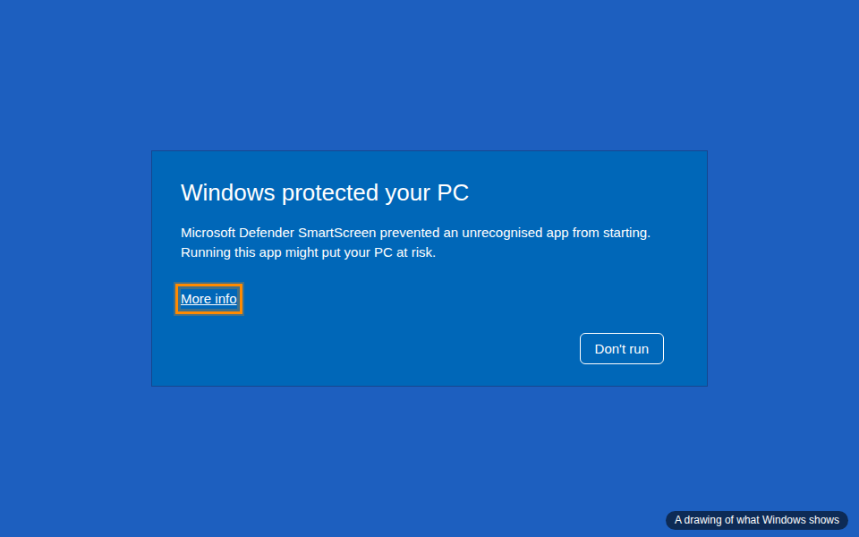

Check that the app is `Lanewise_<version>_x64-setup.exe`, then choose **Run anyway**:

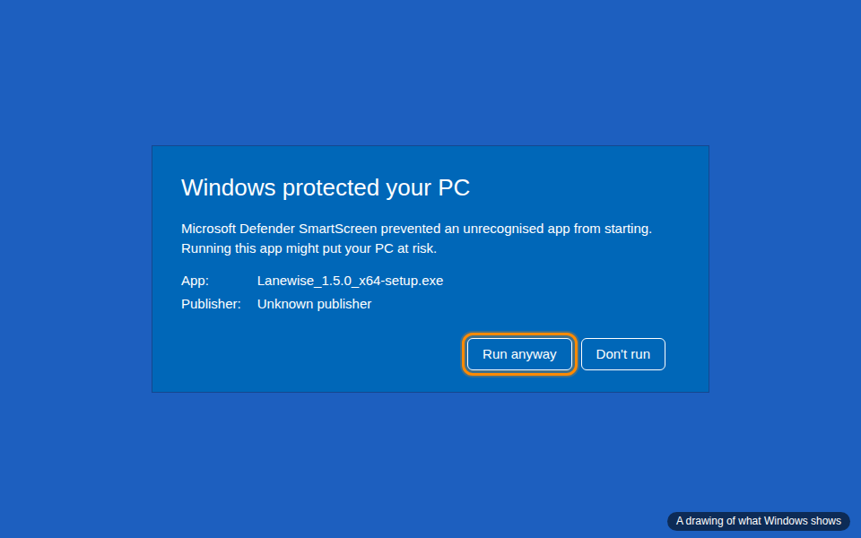

Or, instead, remove the mark Windows puts on a downloaded file, and run the installer from PowerShell. SmartScreen doesn't stop it then:

```powershell
Unblock-File "$HOME\Downloads\Lanewise_*_x64-setup.exe"
Start-Process (Get-Item "$HOME\Downloads\Lanewise_*_x64-setup.exe")
```

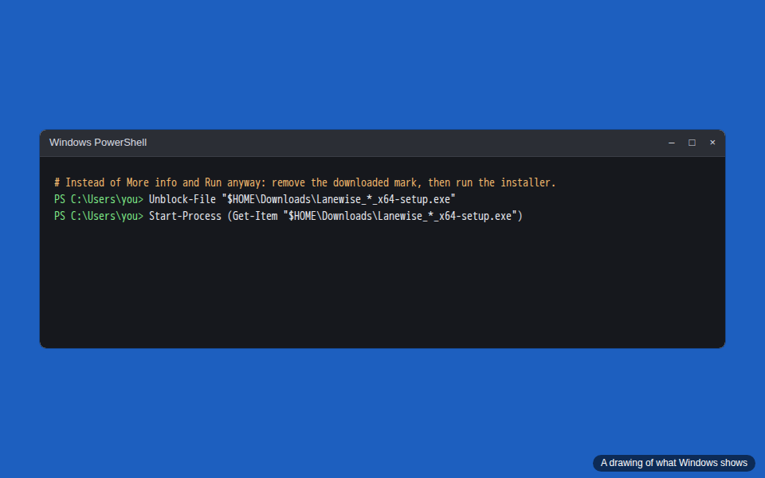

### 7. Install Lanewise

The installer installs Lanewise for you alone, in `C:\Users\<you>\AppData\Local\Lanewise`, without asking for administrator rights, and fetches WebView2 if it isn't there. Choose **Install**:

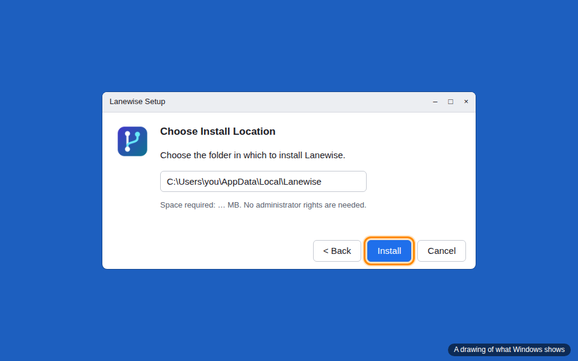

Leave **Run Lanewise** ticked and choose **Finish**:

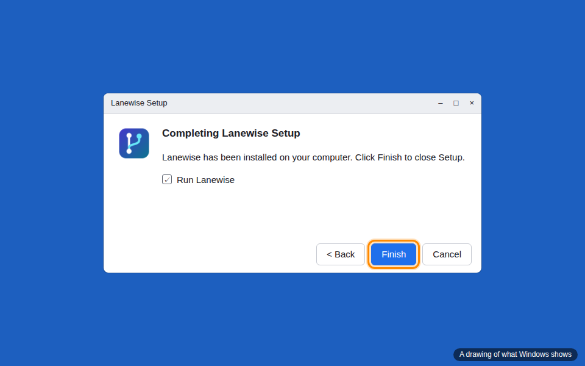

### 8. Open Lanewise

If you left **Run Lanewise** ticked, it's already open. From then on, open **Start**, type `Lanewise` and choose it:

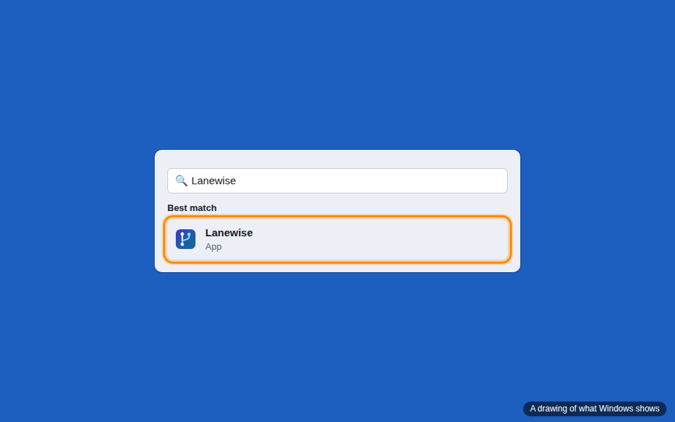

If anything Lanewise needs from Git is missing, it opens on **Set up Git for Lanewise**, which says what it found and what to install, with **Check again** to look again once you have:


Once Git is set up, it opens on the Welcome screen. Carry on with [First steps in Lanewise](first-steps.md).

Lanewise updates itself from then on: **Settings → Updates** says which version is running ([Updates](../installing.md#updates)).

### Uninstalling

Open **Settings → Apps → Installed apps**, find Lanewise, choose **…** beside it and then **Uninstall**. Your API keys stay in Windows Credential Manager until you choose **Forget the API key** in Lanewise's Settings first.

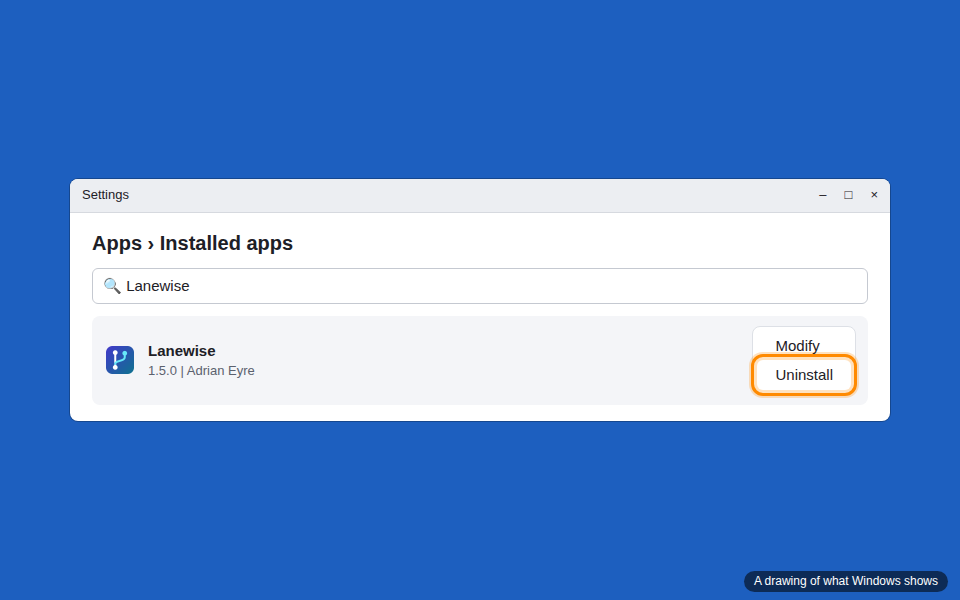

## Part 2: build Lanewise from source

Part 2 needs Git from [step 3](#3-install-git-and-git-credential-manager). It ends with Lanewise running from your clone, its checks passing and its installer built. [Setting Lanewise up locally](../development.md) says more about each command.

### 9. Install the Microsoft C++ Build Tools

Rust builds Windows programs with Microsoft's linker, which comes with the C++ Build Tools. Install them with the **Desktop development with C++** workload, from PowerShell:

```powershell
winget install --id Microsoft.VisualStudio.2022.BuildTools -e --source winget --override "--wait --passive --add Microsoft.VisualStudio.Workload.VCTools --includeRecommended"
```

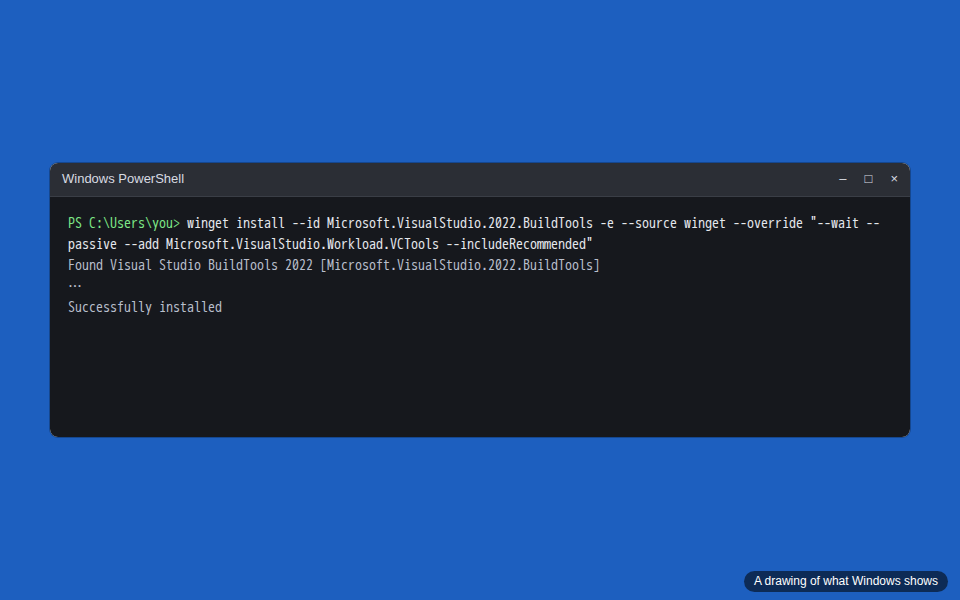

Or download **Build Tools for Visual Studio** from [Visual Studio's downloads](https://visualstudio.microsoft.com/visual-cpp-build-tools/), run it, tick **Desktop development with C++** and choose **Install**:

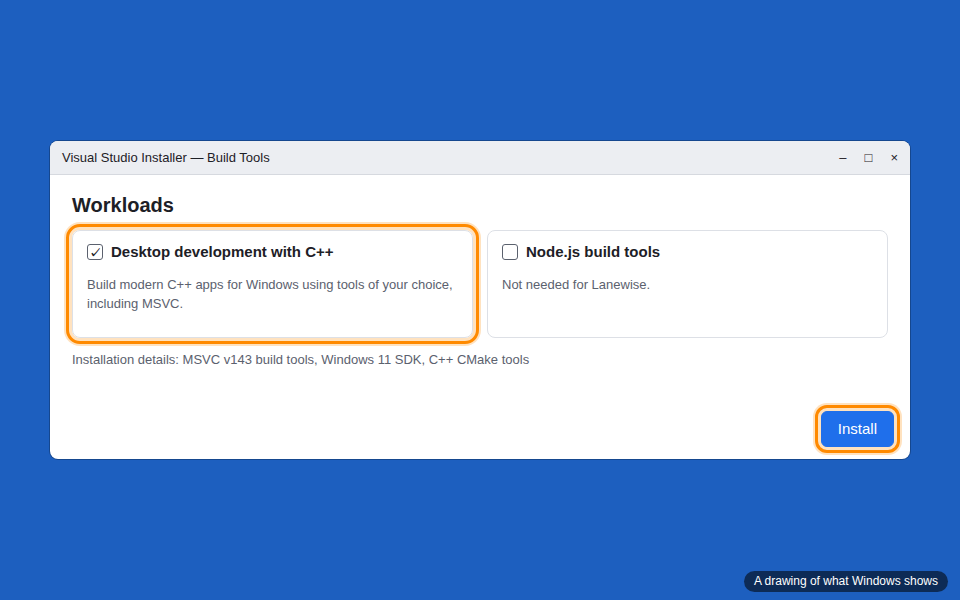

### 10. Check WebView2

WebView2 draws Lanewise's window. It's already on Windows 10 from version 1803, and on Windows 11. To check:

```powershell
Get-ItemProperty 'HKLM:\SOFTWARE\WOW6432Node\Microsoft\EdgeUpdate\Clients\{F3017226-FE2A-4295-8BDF-00C3A9A7E4C5}' -Name pv
```

A version means it's installed. If PowerShell says the path doesn't exist, install the **Evergreen Bootstrapper** from [Microsoft's WebView2 page](https://developer.microsoft.com/microsoft-edge/webview2/).

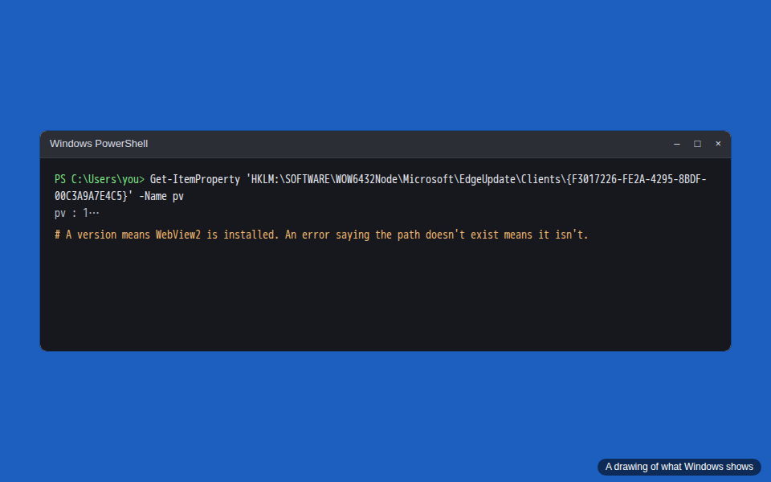

### 11. Install Rust

Install rustup, Rust's installer, from [rustup.rs](https://rustup.rs) or with winget. Open a new terminal, then make the MSVC toolchain the default and add clippy and rustfmt:

```powershell
winget install --id Rustlang.Rustup -e --source winget
# Open a new terminal, then:
rustup default stable-msvc
rustup component add clippy rustfmt
rustc --version
```

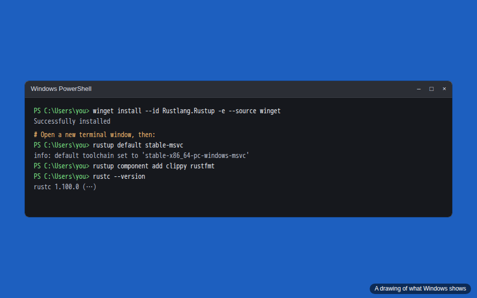

### 12. Install Node 26 with fnm

[fnm](https://github.com/Schniz/fnm), the Fast Node Manager, installs Node versions and switches between them. Install it, have PowerShell load it in every window, then install Node 26:

```powershell
winget install --id Schniz.fnm -e --source winget
# Open a new terminal, then:
New-Item -ItemType File -Force $PROFILE | Out-Null
Add-Content $PROFILE 'fnm env --use-on-cd --shell powershell | Out-String | Invoke-Expression'
. $PROFILE
fnm install 26
fnm default 26
node --version
```

If PowerShell says running scripts is disabled when it loads `$PROFILE`, run `Set-ExecutionPolicy -Scope CurrentUser RemoteSigned` and open a new terminal.

Prefer another way? [nvm-windows](https://github.com/coreybutler/nvm-windows) (`winget install --id CoreyButler.NVMforWindows -e`, then `nvm install 26` and `nvm use 26`), which is a different project from the nvm macOS and Linux use, or the **Windows Installer (.msi)** for Node 26 from [nodejs.org](https://nodejs.org/en/download).

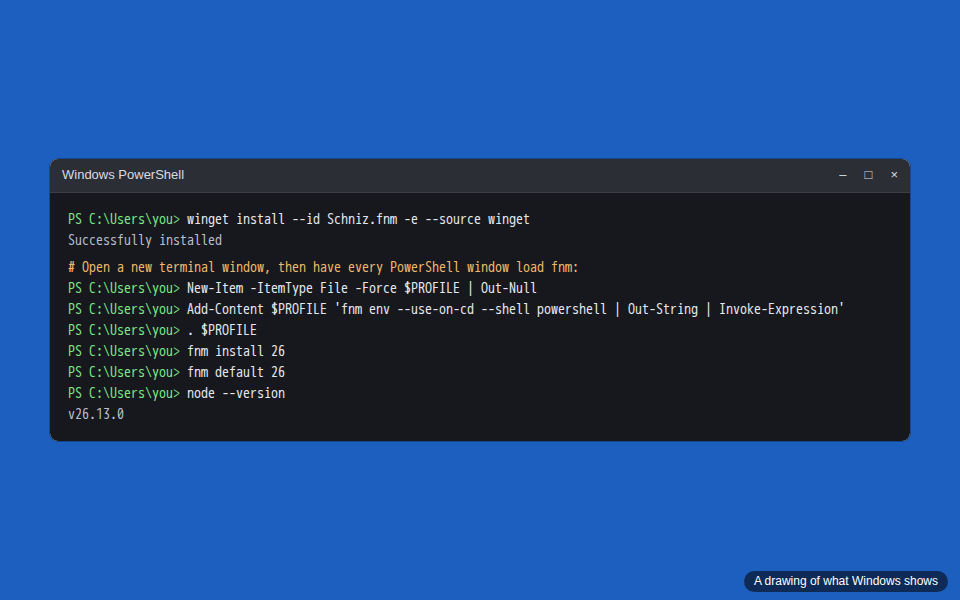

### 13. Turn on corepack, for pnpm

Lanewise uses [pnpm](https://pnpm.io) at the exact version in `package.json`'s `packageManager`. [corepack](https://github.com/nodejs/corepack) provides it. Node no longer comes with corepack, so install it with npm, which comes with Node:

```powershell
npm install -g corepack@latest
corepack enable
corepack --version
```

Don't install pnpm another way as well. Once you've cloned Lanewise in the next step, `pnpm --version` inside the clone prints the version in `packageManager`; corepack downloads it the first time, and may ask first.

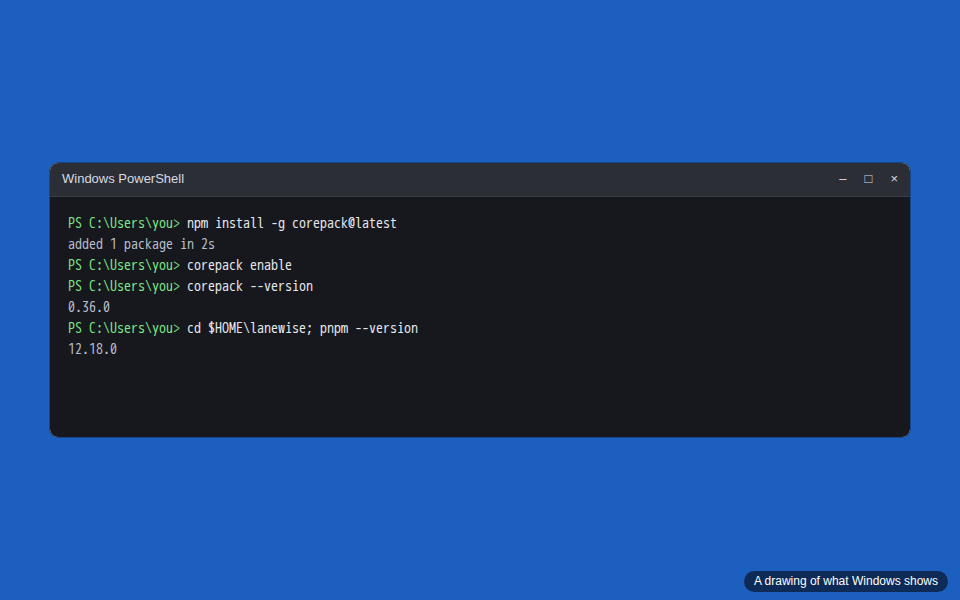

### 14. Clone Lanewise and install its packages

```powershell
cd $HOME
git clone https://github.com/adrianeyre/lanewise.git
cd lanewise
pnpm install --frozen-lockfile
```

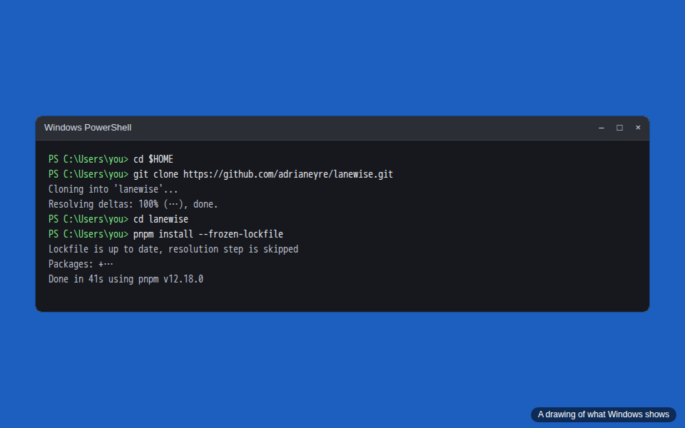

### 15. Run Lanewise from source

```powershell
pnpm desktop:dev
```

The first build compiles every crate and takes several minutes. Then Lanewise's window opens, on the Welcome screen, or on Set up Git for Lanewise if Git isn't ready. A change to the UI reloads at once, and a change to the Rust code rebuilds and restarts it. Press Ctrl+C in the terminal to stop it.

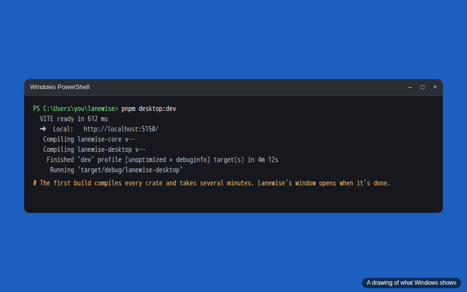

### 16. Run the checks

These three must pass before a commit, as [CONTRIBUTING.md](../../CONTRIBUTING.md) says:

```powershell
pnpm lint
pnpm typecheck
pnpm test
```

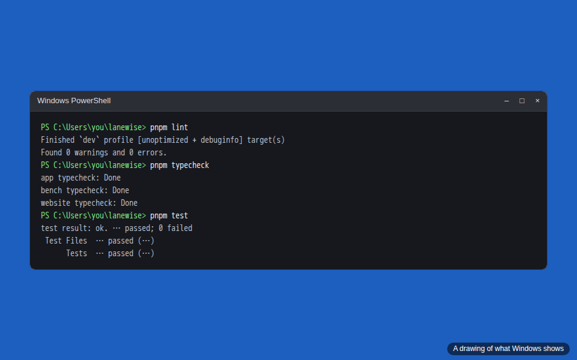

### 17. Build the installer

```powershell
pnpm desktop:build
```

It writes `target\release\bundle\nsis\Lanewise_<version>_x64-setup.exe`, unsigned. Install it as in [step 7](#7-install-lanewise). A copy you build yourself doesn't update itself.

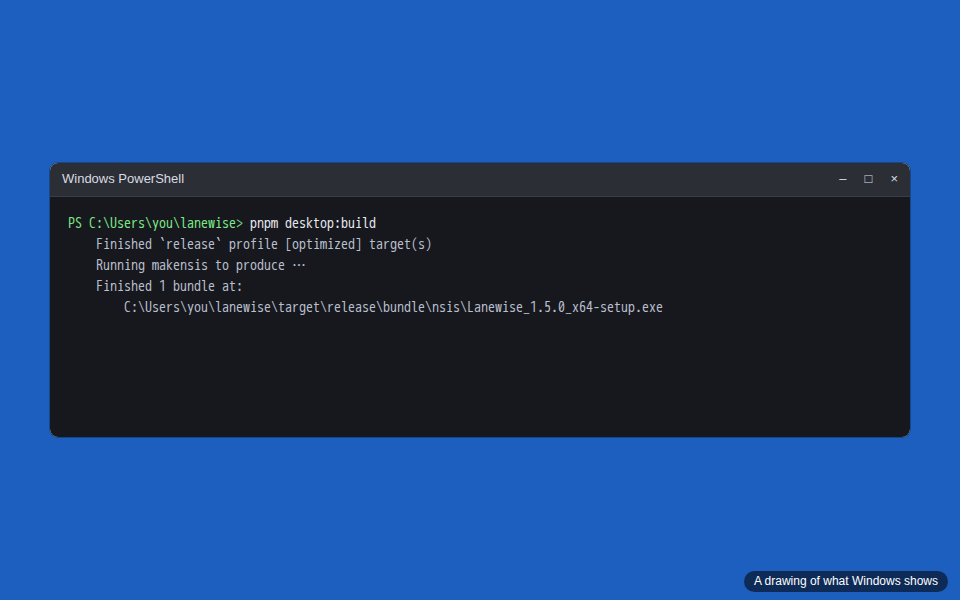

## If something goes wrong

- **`winget` isn't recognised.** Install **App Installer** from the Microsoft Store, or download each tool from its link in [What you need](#what-you-need).
- **`git` isn't recognised after installing it.** Open a new terminal, or sign out and in again, so it reads the new `PATH`.
- **`link.exe` not found, or a `msvc` linker error.** The C++ Build Tools are missing, or Rust uses the GNU toolchain: do [step 9](#9-install-the-microsoft-c-build-tools) and run `rustup default stable-msvc`.
- **SmartScreen has no Run anyway.** Your organisation may have turned it off. Ask its IT, or [build Lanewise yourself](#part-2-build-lanewise-from-source).
- **Anything else.** [Common setup problems](../development.md#common-setup-problems), or [open an issue](https://github.com/adrianeyre/lanewise/issues/new/choose); Settings' **Copy diagnostics** fills its form in.
